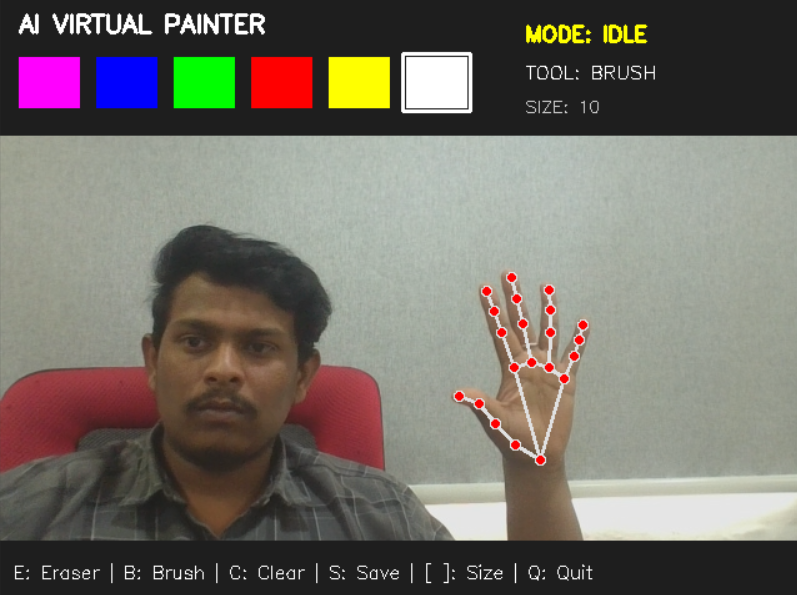
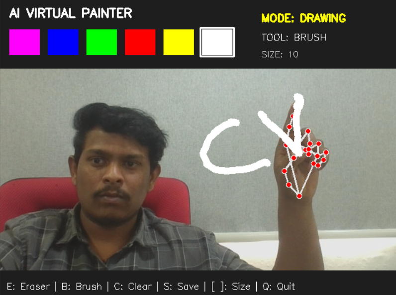
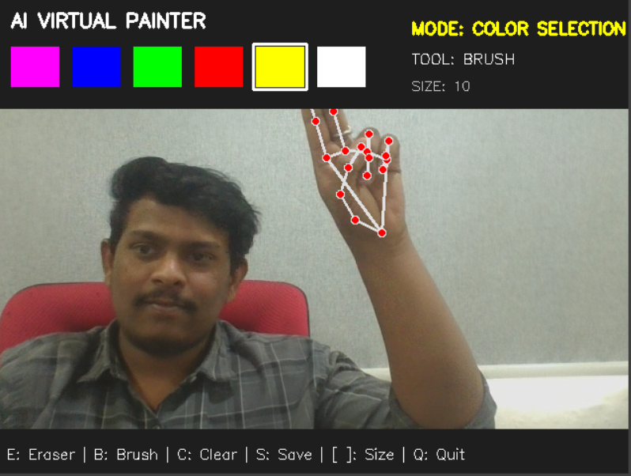

# AI Virtual Painter 🎨

A real-time hand gesture-based virtual painting application built using **Python, OpenCV, and MediaPipe**.

Draw on a virtual canvas using your fingers without touching your computer screen!

## 🚀 Features

- Real-time hand tracking using MediaPipe.
- Detects 21 hand landmarks.
- Draw using your index finger.
- Select drawing colors using a two-finger gesture.
- Pause drawing using a closed-fist gesture.
- Switch between brush and eraser.
- Adjust brush thickness.
- Clear the canvas.
- Save your drawings as images.

## 📸 Project Screenshots

### 1. Main Interface

The main application interface displaying the webcam feed, toolbar, and drawing canvas.



### 2. Drawing Mode

Draw on the virtual canvas using your index finger.



### 3. Color Selection

Select different drawing colors using a two-finger gesture.



## 🛠️ Technologies Used

- **Python** – Main programming language.
- **OpenCV** – Real-time video processing and drawing operations.
- **MediaPipe** – Hand landmark detection and tracking.
- **NumPy** – Canvas creation and array operations.

## ⚙️ Installation and Setup

### 1. Clone the repository

```bash
git clone https://github.com/rahulkumaryenugula0308-dev/AI-Virtual-Painter.git
```

### 2. Navigate to the project folder

```bash
cd AI-Virtual-Painter
```

### 3. Install the required libraries

```bash
pip install -r requirements.txt
```

### 4. Run the application

```bash
python main.py
```

**Note:** Make sure your webcam is connected and accessible before running the application.

## 🎮 Controls

| Gesture / Key | Action |
|---|---|
| Index finger | Draw |
| Index + Middle fingers | Select color |
| Closed fist | Pause drawing |
| B | Brush |
| E | Eraser |
| C | Clear canvas |
| S | Save drawing |
| `[` | Decrease brush size |
| `]` | Increase brush size |
| Q | Quit application |

## 📂 Project Structure

```text
AI-Virtual-Painter/
│
├── main.py
├── requirements.txt
├── README.md
├── .gitignore
│
├── screenshots/
│   ├── main_interface.png
│   ├── drawing_mode.png
│   └── color_selection.png
│
└── output/  (Generated drawings)
```

## 🎯 Learning Outcomes

- Developed a real-time computer vision application.
- Learned hand landmark detection and tracking.
- Implemented gesture recognition using hand landmarks.
- Practiced image processing using OpenCV.
- Worked with MediaPipe and NumPy.
- Integrated computer vision techniques into an interactive application.

## 👨‍💻 Author

Developed as a hands-on Computer Vision project using Python.

**GitHub Repository:**  
https://github.com/rahulkumaryenugula0308-dev/AI-Virtual-Painter